  

  

  
  
  
  

  &nbsp;
  &nbsp;
  

## 👾 About me

I'm a **UI/UX designer who ships games.** I design interfaces in Figma, then build them into fast, playful browser games — the kind kids (and grown-ups) actually want to play.

- 🎨 **Design** — UI/UX, game UI and interaction design in Figma
- 🎮 **Build** — HTML5 games in vanilla JavaScript: no frameworks, no build step, quick to load
- 🔁 **Port** — Unity projects rebuilt as lightweight web games that open with a single link
- 🗣️ **Story** — voiced, character-led learning adventures
- 🌍 **Work** — remote-first, collaborating with clients and teams across time zones

## 🏆 Achievements unlocked

  

## 🎮 Level select

Real games, live in the browser — tap a card to play.

  
  

  
  

  
  

<b>📚 Open the full game library — 25 playable games</b>

 

| Game | What you learn | Play | Code |
| :-- | :-- | :-: | :-: |
| **📐 Geometry & shapes** | | | |
| Frozen Rush 2 | Polygons — mend the mammoth's icy path | [▶ Play](https://frozen-rush-2.vercel.app) | [repo](https://github.com/tarun-figmaboy-838/frozen-rush-2) |
| Frozen Rush | Recognising polygons by their sides | [▶ Play](https://running-mammoth.vercel.app) | [repo](https://github.com/tarun-figmaboy-838/running-mammoth) |
| Polygon Adventure | Narrated lesson + ice-runner game: diagonals, convex & concave | [▶ Play](https://polygon-part-1.vercel.app) | [repo](https://github.com/tarun-figmaboy-838/POLYGON-PART-1) |
| Polygon Adventure 2 | Polygon lesson that opens on Frozen Rush | [▶ Play](https://polygon-2-seven.vercel.app) | [repo](https://github.com/tarun-figmaboy-838/polygon-2) |
| Swiftee & the Polygons | 31 screens: diagonals, convex/concave, regular/irregular | [▶ Play](https://polygone-learnig-game.vercel.app) | [repo](https://github.com/tarun-figmaboy-838/polygone-learnig-game) |
| Fishing Frenzy | Voiced adventure: triangles, pentagons, hexagons | [▶ Play](https://fishing-frenzy-beta.vercel.app) | [repo](https://github.com/tarun-figmaboy-838/fishing-frenzy) |
| Fishing Frenzy 2 | Voiced adventure about parallelograms | [▶ Play](https://fishing-frenzy-2-t6d6.vercel.app) | [repo](https://github.com/tarun-figmaboy-838/fishing-frenzy-2) |
| Popo's Parallelogram Net | Parallelograms (Grade 8) | [▶ Play](https://catch-fish-livid.vercel.app) | [repo](https://github.com/tarun-figmaboy-838/catch-fish) |
| Popo's Shape Fishing | Early shape recognition | [▶ Play](https://ice-age-fishing.vercel.app) | [repo](https://github.com/tarun-figmaboy-838/ice-age-fishing) |
| Popo's Trapezium Fishing | Trapeziums across five levels | [▶ Play](https://ice-age-fishing-2.vercel.app) | [repo](https://github.com/tarun-figmaboy-838/ice-age-fishing-2) |
| Bridge Builder: Triangles | Classifying triangles (Grade 8) | [▶ Play](https://beaver-builder-three.vercel.app) | [repo](https://github.com/tarun-figmaboy-838/BEAVAR-BUILDER) |
| Fence the Farm | Perimeter and area | [▶ Play](https://goat-kappa-two.vercel.app) | [repo](https://github.com/tarun-figmaboy-838/GOAT) |
| **🔢 Numbers, measurement & logic** | | | |
| Fraction Quest | Fractions across six levels | [▶ Play](https://fraction-quest-eta.vercel.app) | [repo](https://github.com/tarun-figmaboy-838/fraction-quest) |
| Count and Match | Counting and matching quantities | [▶ Play](https://lbd3-count-and-match.vercel.app) | [repo](https://github.com/tarun-figmaboy-838/lbd3-count-and-match) |
| Hidden Gem Sequence | Number order | [▶ Play](https://lbd1-gamma.vercel.app) | [repo](https://github.com/tarun-figmaboy-838/lbd1) |
| Kabir and the Lost Princess | Story-led maths game | [▶ Play](https://lbd2-n437.vercel.app) | [repo](https://github.com/tarun-figmaboy-838/lbd2) |
| Shoe by Shoe | Measuring length in shoes | [▶ Play](https://shoe-by-shoe-lbd-1-web.vercel.app) | [repo](https://github.com/tarun-figmaboy-838/ShoeByShoe_LBD-1_web) |
| Fancy Dress: How Many Blocks? | Counting blocks | [▶ Play](https://fancy-dress-lbd2-web-ls34.vercel.app) | [repo](https://github.com/tarun-figmaboy-838/fancy-dress-lbd2-web) |
| Fancy Dress: Heavy & Light | Comparing weight | [▶ Play](https://fancy-dress-lbd1-web.vercel.app) | [repo](https://github.com/tarun-figmaboy-838/fancy-dress-lbd1-web) |
| Fancy Dress 2: Balancing Act | Balance and equal weight | [▶ Play](https://fancy-dress-2-web.vercel.app) | [repo](https://github.com/tarun-figmaboy-838/fancy-dress-2-web) |
| Royal Bloom | Balance-scale reasoning | [▶ Play](https://royal-bloom-two.vercel.app) | [repo](https://github.com/tarun-figmaboy-838/royal-bloom) |
| Juice Genie | Capacity — which holds more? | [▶ Play](https://palce-turn-25-1.vercel.app) | [repo](https://github.com/tarun-figmaboy-838/PALCE-TURN-25--1-) |
| Fish Counting Game | Counting | [▶ Play](https://fish-rescue-2.vercel.app) | [repo](https://github.com/tarun-figmaboy-838/fish-rescue-2) |
| **📅 Time** | | | |
| Bubble Days | Days of the week, musical popcorn style | [▶ Play](https://seven-day-game.vercel.app) | [repo](https://github.com/tarun-figmaboy-838/seven-day-game) |
| Days of the Week | Putting the days in order | [▶ Play](https://days-of-the-week-game-1.vercel.app) | [repo](https://github.com/tarun-figmaboy-838/Days-of-the-Week-Game--1-) |

## 🤝 Work with me

**Remote-first and open to the world.** I team up with clients, studios and companies anywhere — clear communication, async-friendly updates, and playable builds early and often.

<table>
<tr>
<td width="50%" valign="top">

### 🎮 Clients · freelance

- **HTML5 & educational games** that run in any browser — no app store, no install
- **UI/UX design** for apps, websites and game interfaces, in Figma
- **Unity → Web ports** — lighter builds that reach more players
- **Prototype → launch** — from clickable prototype to a live, hosted link

</td>
<td width="50%" valign="top">

### 🏢 Companies · full-time

- **Roles:** UI/UX Designer · Game Designer · Creative Front-end Developer
- **Strengths:** game-based learning, interaction design, lightweight web builds
- **Setup:** remote-first, working across time zones
- **Proof:** 25+ live games you can play right now ↑

</td>
</tr>
</table>

  

  &nbsp;
  
  <!-- ✏️ ADD YOUR CONTACT LINKS: put in your real email / LinkedIn, then delete this line and the closing line below.
  &nbsp;
  &nbsp;
  -->

💬 <b>Start a project</b> opens a short inquiry form right here on GitHub — freelance, contract or full-time, from anywhere in the world.

## 🧰 Toolkit

  

## 📈 Player stats

  

  <picture>
    <source media="(prefers-color-scheme: dark)" srcset="https://raw.githubusercontent.com/tarun-figmaboy-838/tarun-figmaboy-838/output/snake-dark.svg">
    <source media="(prefers-color-scheme: light)" srcset="https://raw.githubusercontent.com/tarun-figmaboy-838/tarun-figmaboy-838/output/snake-light.svg">
    
  </picture>

  

